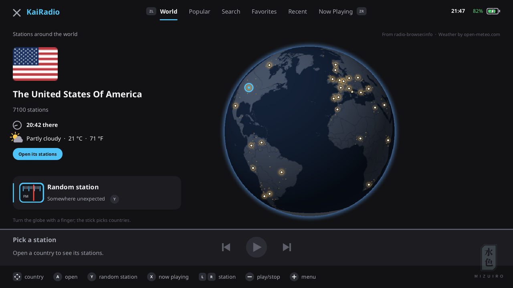
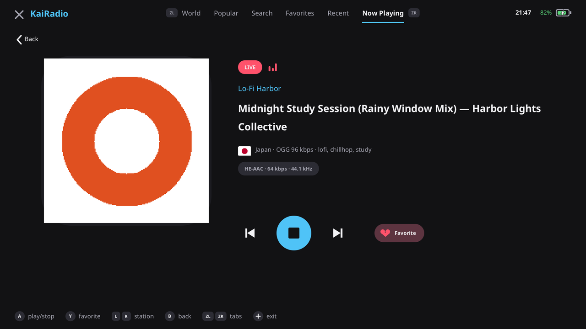
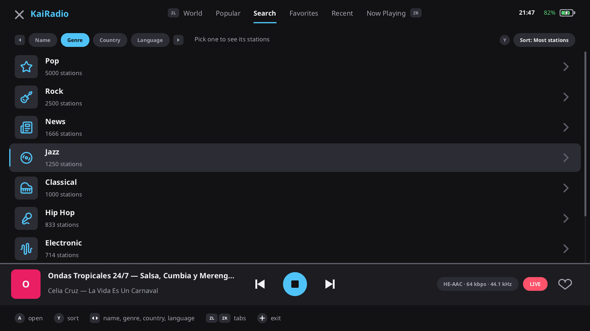

# KaiRadio

An **open-source internet radio player** for **Switch 2** running
[kaiHEN](https://github.com/ouncebrew/kaihen), in the spirit of
[KaiPlayer](https://github.com/mizuiroame/kaiplayer). Browse tens of
thousands of public stations from the community
[Radio Browser](https://www.radio-browser.info/) directory: the most played
ones, by country on a map of the world, or by name, genre, country or
language.



| Popular | Now Playing | Search by genre |
|---------|-------------|-----------------|
|  |  |  |

The screenshots show made-up stations.

> **Beta.** KaiRadio works, but it's young: tell us what doesn't.
>
> KaiRadio is an independent project. It is not affiliated with, endorsed by
> or sponsored by Nintendo, Radio Browser or any station. See the
> [Legal notice](#legal-notice).

## What it does

- **World**: a night map of the world, each country lit up by how many
  stations it has. Move between countries and open one to see its stations.
- **Popular**: the stations played most, worldwide.
- **Search** by **name** (with the console's keyboard), or browse **genres**
  (each with an icon), **countries** (with their flags) and **languages**
  (with letters in their own script), each with how many stations it has.
- **Favorites** and **Recent**: kept on your card in
  `sdmc:/config/kairadio/`.
- **Now Playing**: the station's logo, the song playing when the station sends
  it, and the format: codec, bitrate and sample rate.
- Plays **MP3**, **AAC** and **HE-AAC**, **Ogg Vorbis**, **Opus** and **FLAC**
  streams over HTTP and HTTPS. It follows `.pls` and `.m3u` playlists to the
  stream, and plays **HLS** stations (MPEG-TS or AAC segments; fMP4 isn't
  supported yet).
- Reconnects on its own when the connection drops.
- **Settings** (**+** > Settings): the accent color (or one taken from the
  station's logo), a background image of your own with as much blur as you
  like, a 12- or 24-hour clock, a sleep timer, turning the screen off while
  a station plays, the tab to start in, and playing the last station again
  when KaiRadio opens. Backgrounds are the JPEG or PNG images you put in
  `sdmc:/config/kairadio/Backgrounds`.
- Drawn on the GPU, sharp in handheld and docked. Every control works with the
  buttons and the touch screen.

## Install

You need a Switch 2 with **kaiHEN** running (launch a game while holding
**R** to open hbmenu), a Wi-Fi connection, and a way to copy a file to the
card: OunceShell's FTP server with an FTP client such as
[FileZilla](https://filezilla-project.org/), or
[KaiDrop](https://github.com/mizuiroame/kaidrop).

1. Download `KaiRadio.nro` from the latest release on the
   **[Releases](../../releases)** page.
2. In hbmenu, open **OunceShell** and start its FTP server. It shows the
   console's address and port.
3. Connect to it from your PC and copy `KaiRadio.nro` into the `switch`
   folder, so it is `sdmc:/switch/KaiRadio.nro`.
4. Open hbmenu and select **KaiRadio**.

> **Don't take the microSD card out while kaiHEN is running.** Removing it
> means restarting the console, and kaiHEN has to be started again after
> that.

## Controls

| Button | What it does |
|--------|--------------|
| **A** | Play the selected station (in World: open the country; in Now Playing: play or stop) |
| **Y** | Add to favorites, or remove; on a list of genres, countries or languages, sort it (most or fewest stations, A to Z, Z to A) |
| **X** | Now Playing; in Search by name, type a name |
| **ZL** / **ZR** | Previous / next tab |
| **L** / **R** | Previous / next station, in the list you played from |
| **◀** / **▶** | In World: the country that way. In Search: by name, genre, country or language. Elsewhere: a page up or down |
| **↑** / **↓** | Move in the list; in World, the country that way |
| **B** | Back (out of Now Playing, or out of a genre, country or language, to the map if opened from it) |
| **−** | Play or stop |
| **+** | Menu: Settings, or exit (press **+** again to exit) |

On the touch screen, tap a station to play it, its heart to keep it, a tab,
genre or country to open it, a country on the map to pick it (tap it again,
or its card, to open it), the sort at the top right of a list of genres,
countries or languages to change it, and the bar at the bottom for Now Playing. Drag
a list to scroll it. The title at the top left opens the menu, and the **×**
before it exits.

## Building

KaiRadio is built in Docker, on top of the
[ounce-devkit](https://github.com/ouncebrew/ounce-devkit) image:

```sh
docker build -t kairadio-devkit ffmpeg   # once: the devkit plus FFmpeg (LGPL)
.\build.ps1                              # KaiRadio.nro
.\build.ps1 test                         # host tests
.\build.ps1 preview                      # screenshots and touch checks
```

`ffmpeg/Dockerfile` builds FFmpeg 7.1 from its release tarball (checked by
SHA-256) with only the demuxers, parsers and audio decoders radio needs, and
fails if the build would include GPL or non-free parts.

While a station plays, KaiRadio writes how the audio output keeps up to
`sdmc:/config/kairadio/audio.log`. It helps when a station stutters.

## Legal notice

- **Independent project.** KaiRadio is not affiliated with, endorsed by or
  sponsored by Nintendo Co., Ltd. or its subsidiaries, by Radio Browser, or by
  any radio station.
- **Trademarks.** "Nintendo", "Nintendo Switch" and "Switch 2" are trademarks
  of their owners. They are used here only to say which hardware this program
  works with. Format names are used only to name the streams KaiRadio plays.
- **No Nintendo material.** This repository and its releases contain no
  Nintendo code, SDK, firmware, cryptographic keys, games, or graphics or audio
  assets. KaiRadio is built only with open-source tools and libraries.
- **Stations.** KaiRadio ships no station list, logos or broadcasts. It plays
  the public streams that stations publish themselves, as any web radio player
  does, and it doesn't record them. Each station's content belongs to its
  owners. The station list comes from Radio Browser's public API, and KaiRadio
  reports plays to it, as the API asks clients to.
- **FFmpeg.** KaiRadio uses FFmpeg, built under the LGPL 2.1 (no GPL or
  non-free parts). The script that builds it is in this repository, so it can
  be rebuilt, changed and relinked.
- **User responsibility.** Running homebrew (kaiHEN) can put your console at
  risk, can affect its warranty and can go against the manufacturer's terms of
  service. You do it at your own risk.
- **No warranty.** The software is provided "as is", without warranty of any
  kind. See [LICENSE](LICENSE).

This notice is not legal advice.

## License

KaiRadio is released under the [MIT License](LICENSE). FFmpeg is released
under the LGPL 2.1; the other bundled libraries are listed in
[third_party/VERSIONS.md](third_party/VERSIONS.md). The world map is drawn
from [Natural Earth](https://www.naturalearthdata.com/) (public domain) by
`tools/make_map.py`; the flags come from
[flag-icons](https://github.com/lipis/flag-icons) (MIT) and the genre icons
from [Lucide](https://lucide.dev/) (ISC).
