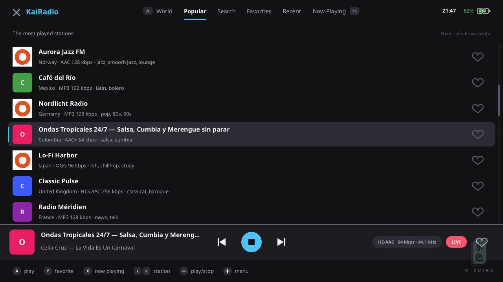
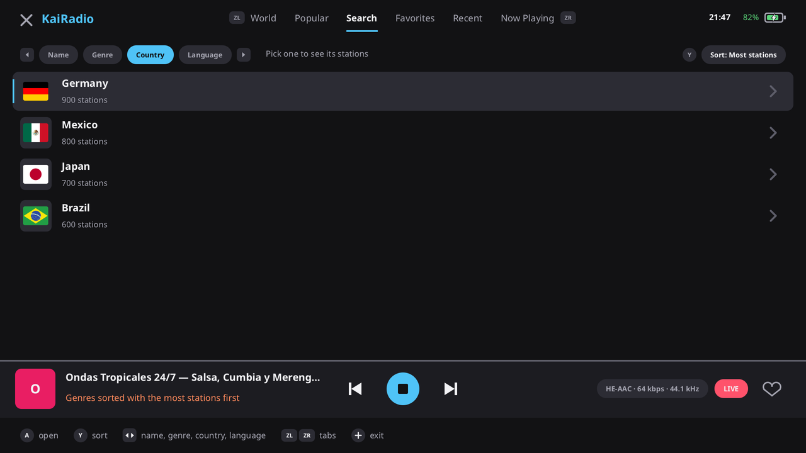
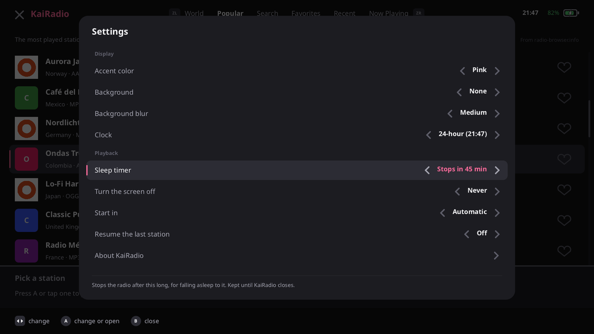

# KaiRadio

An **open-source internet radio player** for **Switch 2** running
[kaiHEN](https://github.com/ouncebrew/kaihen), in the spirit of
[KaiPlayer](https://github.com/mizuiroame/kaiplayer). Browse tens of
thousands of public stations from the community
[Radio Browser](https://www.radio-browser.info/) directory: the most played
ones, by country on a globe you turn with a finger, at random, or by name,
genre, country or language.

| Popular | Now Playing | Search by genre |
|---------|-------------|-----------------|
|  |  |  |

| Search by country | Settings |
|-------------------|----------|
|  |  |

The screenshots show made-up stations.

> KaiRadio is an independent project. It is not affiliated with, endorsed by
> or sponsored by Nintendo, Radio Browser or any station. See the
> [legal notice](docs/legal.md).

## What it can do

- **World**: a night globe, each country lit up by how many stations it has,
  with its flag, **time and weather**. Or a flat night map.
  [More](docs/stations.md#world)
- **Random station** (**Y** in World): a country at random and one of its
  stations playing. [More](docs/stations.md#random-station)
- **Popular**, **Search** by name, and **genres**, **countries** and
  **languages** to browse. [More](docs/stations.md#popular-and-search)
- **Favorites** and **Recent**, kept on your card.
  [More](docs/stations.md#favorites-and-recent)
- **Podcasts**: your region's top podcasts, by genre too, or find one by
  name; subscribe, and new episodes are looked for each time KaiRadio starts.
  An episode plays from where you left it, with a progress bar, back 15 s and
  ahead 30 s, and a tick once heard.
- **Now Playing**: the station's logo, the song playing and the format.
  [More](docs/playback.md#now-playing)
- Plays **MP3**, **AAC** and **HE-AAC**, **Ogg Vorbis**, **Opus** and **FLAC**
  streams, `.pls` and `.m3u` playlists and **HLS** stations. Reconnects on its
  own. [More](docs/playback.md#streams-it-plays)
- **In nine languages**: English, Spanish, French, Italian, Portuguese, German,
  Japanese, Chinese and Korean, and more can be added as files.
  [More](docs/languages.md)
- **Settings** in three pages, Playback, Display and About: sleep timer,
  screen off while playing, language, accent color, your own background,
  clock, and more. [More](docs/settings.md)
- Drawn on the GPU, sharp in handheld and docked. **Touch and buttons** for
  every control. [Controls](docs/controls.md)

## Install

You need a Switch 2 with **kaiHEN** running (launch a game while holding
**R** to open hbmenu), a Wi-Fi connection, and a way to copy a file to the
card: OunceShell's FTP server with an FTP client such as
[FileZilla](https://filezilla-project.org/), or
[KaiDrop](https://github.com/mizuiroame/kaidrop).

1. Download `KaiRadio.nro` from the latest release on the
   **[Releases](../../releases)** page.
2. In hbmenu, open **OunceShell** and start its FTP server. It shows the
   console's address and port.
3. Connect to it from your PC, make a `kairadio` folder inside the `switch`
   folder and copy `KaiRadio.nro` into it, so it is
   `sdmc:/switch/kairadio/KaiRadio.nro`. (Straight in `switch` works too.)
4. Open hbmenu and select **KaiRadio**.

> **Don't take the microSD card out while kaiHEN is running.** Removing it
> means restarting the console, and kaiHEN has to be started again after
> that.

## Documentation

- [Finding stations](docs/stations.md): World, random station, Popular,
  Search, Favorites and Recent
- [Playback](docs/playback.md): Now Playing, the streams it plays, when a
  station stutters
- [Settings and files](docs/settings.md): every setting, backgrounds, where
  KaiRadio keeps its files
- [Languages](docs/languages.md): choosing one, and translating KaiRadio
- [Controls](docs/controls.md): buttons and touch
- [Building](docs/building.md)
- [Security](SECURITY.md): what KaiRadio connects to and keeps, and how to
  report a problem
- [Legal notice and licenses](docs/legal.md)

## License

KaiRadio is released under the [MIT License](LICENSE). It uses FFmpeg under
the LGPL 2.1, and other open-source libraries (curl, zlib, Mesa through
OunceVK, cJSON, stb), data and icons. The full list
is in [docs/legal.md](docs/legal.md#licenses).
